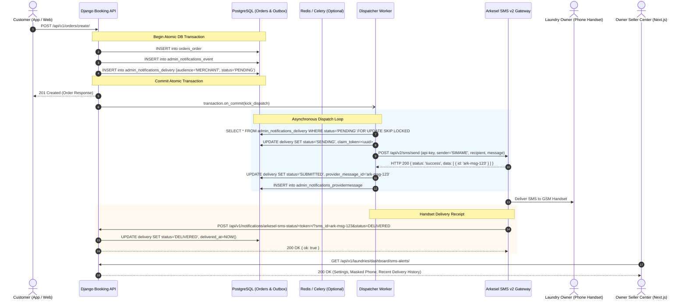

# 02 — System Design & Architecture

## 1. Architectural Principles

The SIMAME Laundry Owner SMS Notification System is architected around five fundamental tenets:

1. **Non-Blocking Booking Path**: An HTTP booking request made by a customer must NEVER perform synchronous network calls to external SMS gateways. Booking transaction commits must execute with sub-second latencies (<50ms database commit time).
2. **Durable Transactional Outbox**: All notifications are recorded as relational database entities inside the exact same atomic transaction that creates or updates the order. If the booking transaction rolls back, zero notification records exist. If Redis or Celery crashes, the outbox retains the message persistently in PostgreSQL.
3. **Idempotency & Deduplication**: Repeated webhooks from Paystack, network retries, or concurrent dispatcher passes must never generate duplicate intended SMS notifications to laundry owners.
4. **Tenant Isolation**: Every order alert is strictly tied to the assigned fulfilling laundry. An owner cannot view or receive alerts belonging to another merchant.
5. **Horizontal Concurrency via `SKIP LOCKED`**: Worker dispatchers across multiple processes or Celery nodes claim batches using `SELECT ... FOR UPDATE SKIP LOCKED`. Multiple workers running in parallel will never double-claim or race on the same delivery.

---

## 2. End-to-End System Flow Diagram



---

## 3. Component Breakdown

### 3.1 Outbox & Event Emission (`outbox.py`)
- Emits business events during state changes in `ordering` and `payments`.
- Uses `build_order_snapshot(order)` to freeze customer, pickup, delivery, items, laundry, and payment details in JSON.
- Creates `AdminNotificationEvent` with unique idempotency key (e.g. `NEW_ORDER:<uuid>` or `PAYMENT_CONFIRMED:<uuid>`).
- Calls `merchant.merchant_delivery_for(event, order)` to generate the child `AdminNotificationDelivery` row for the fulfilling laundry.

### 3.2 Dual-Mode Background Dispatcher
SIMAME operates in dual-mode to support both containerized cloud deployments with Celery and lightweight single-instance deployments:
1. **Celery Worker Mode (`ADMIN_NOTIFICATIONS_USE_CELERY = True`)**:
   - `kick_dispatch()` enqueues `dispatch_notifications_task.delay()` via `utils.tasks.safe_task_delay`.
   - Dedicated Celery task consumes from the `notifications` queue.
   - Allows independent horizontal scaling of SMS workers without loading web API pods.
2. **In-Process ThreadPool Mode (`ADMIN_NOTIFICATIONS_USE_CELERY = False`)**:
   - Falls back gracefully to bounded background worker threads (`concurrent.futures.ThreadPoolExecutor(max_workers=1)`).
   - Coalesces rapid kicks so that a burst of 50 simultaneous bookings schedules at most one waiting pass.
   - Reinforced by `request_finished` signal sweeps (`maybe_sweep_after_request`) and management command cron jobs (`manage.py dispatch_admin_notifications`).

### 3.3 Locking & Concurrency Model
The dispatcher executes row claiming via the following SQL query:
```sql
SELECT id FROM admin_notifications_delivery
WHERE status IN ('PENDING', 'RETRY')
  AND next_attempt_at <= NOW()
  AND (
    (audience = 'ADMIN' AND channel IN ('SMS', 'WHATSAPP', 'TELEGRAM'))
    OR (audience = 'MERCHANT' AND channel = 'SMS')
  )
  AND NOT EXISTS (
    SELECT 1 FROM admin_notifications_delivery earlier
    WHERE earlier.event_id IN (
      SELECT id FROM admin_notifications_event WHERE order_id = admin_notifications_delivery.order_id
    )
    AND earlier.channel = admin_notifications_delivery.channel
    AND earlier.recipient = admin_notifications_delivery.recipient
    AND earlier.created_at < admin_notifications_delivery.created_at
    AND earlier.status IN ('PENDING', 'RETRY', 'SENDING')
  )
ORDER BY next_attempt_at ASC, created_at ASC
FOR UPDATE SKIP LOCKED
LIMIT 25;
```
**Benefits:**
- Workers immediately skip locked rows without blocking.
- In-flight sequence preservation ensures `ORDER_CANCELLED` is never sent before `NEW_ORDER`.
- Claim tokens prevent slow workers from overwriting newer outcomes.

---

## 4. Delivery State Machine

| State | Meaning | Transition Triggers |
| :--- | :--- | :--- |
| `PENDING` | Created in outbox; awaiting worker claim | Outbox emission |
| `SENDING` | Claimed by worker; claim token leased | Worker claim pass (`SKIP LOCKED`) |
| `SUBMITTED` | Accepted by Arkesel API v2 gateway | HTTP 200 from Arkesel with message ID |
| `DELIVERED` | Handset received message | Webhook callback with status `DELIVERED` |
| `UNDELIVERED`| Failed at telecom carrier / handset off | Webhook callback with status `NOT_DELIVERED` |
| `BLOCKED` | Suppressed safely (unverified, no phone, disabled) | Pre-dispatch validation in worker |
| `RETRY` | Transient network error or 5xx from provider | HTTP timeout, 429, or 500 error |
| `FAILED` | Permanent provider error (invalid key, bad format) | HTTP 401, 403, 422, or credit exhaustion |
| `UNKNOWN` | HTTP connection dropped after send | Read timeout where provider acceptance is uncertain |
| `DEAD` | Retries exhausted or age > `max_age_hours` (12h) | Max attempt count reached |
